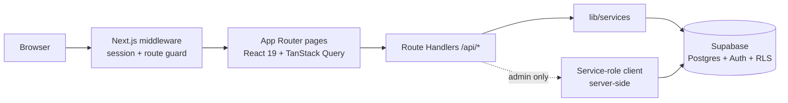
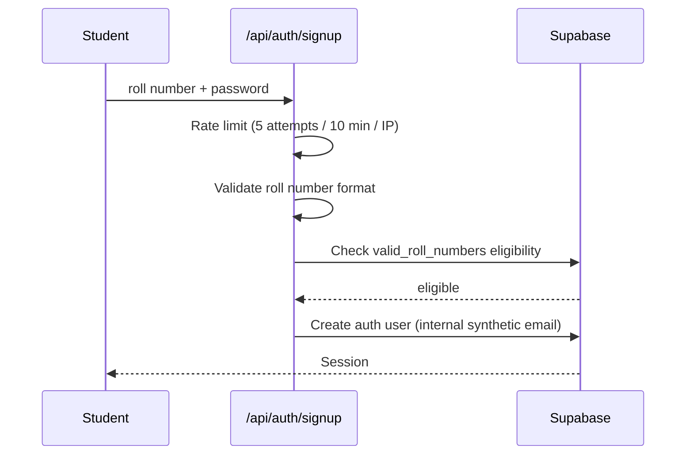

<div align="center">

# PlacePort

### Campus placement intelligence, crowdsourced and structured.

Round-by-round interview experiences from students who actually sat the process, built for **Amrita Vishwa Vidyapeetham, Amaravati campus**.

[](https://placeport-lime.vercel.app/)


</div>

---

## Table of Contents

- [Why PlacePort](#why-placeport)
- [Features](#features)
- [Architecture](#architecture)
- [Authentication](#authentication)
- [Security and Privacy](#security-and-privacy)
- [Tech Stack](#tech-stack)
- [Getting Started](#getting-started)
- [Environment Variables](#environment-variables)
- [Database Setup](#database-setup)
- [Scripts](#scripts)
- [Testing](#testing)
- [Project Structure](#project-structure)
- [Deployment](#deployment)
- [Roadmap](#roadmap)
- [Contributing](#contributing)
- [Author](#author)

---

## Why PlacePort

Placement knowledge on campus lives in WhatsApp forwards and memory. PlacePort gives anyone who has faced an interview (selected or not) a structured place to document the rounds, the questions, what worked, what to avoid, and which resources helped, so the next batch prepares with signal instead of noise.

It is not a senior-to-junior mentoring model. Every experience is first-class.

> Please do not post confidential company material or NDA-covered question papers. Share experiences and preparation advice only.

## Features

**Sharing**
- Structured posts: company, role, year, branch, package range (LPA) and outcome.
- **Round builder** with drag-and-drop ordering (`@dnd-kit`). Contributors define rounds in their own order, so pipelines that start with a GD or an online assessment are represented accurately.
- Do's, don'ts, helpful resource links, overall experience and preparation tips.

**Discovery**
- Feed of experience cards with search and filters (company, branch, year, outcome) and sorting.
- Full detail page per experience (`/experiences/[id]`) showing every round in order.
- Company pages with an aggregated summary (`/company/[slug]`).
- Resources catalogue, saved posts, and contributor profile pages.

**Community**
- Helpful votes and bookmarks.
- Contributor badges and in-app notifications.
- Authors are shown by **masked roll number** rather than name, so people who prefer privacy can still contribute.

**Moderation (admin)**
- Admin console to manage the approved roll-number roster, review user reports, hide or delete posts, manage users and reset passwords.

## Architecture



- **UI components** render only; data access goes through hooks and route handlers.
- **`lib/services`** (`experienceService`, `profileService`, `rollNumberService`) are the layer that talks to the database.
- **`lib/auth`** exposes an `AuthService` interface with a Supabase implementation, so the provider can be swapped in one place.
- **Validation** uses Zod schemas (`lib/validations`) shared between forms and API routes.
- **Mock mode:** when Supabase variables are missing or contain `placeholder`, the app falls back to an in-memory store (`lib/mockStore.ts`) so you can run the UI locally with no backend.

## Authentication

Students sign in with **roll number + password**. There are no email flows for students.



- Each roll number maps to an **internal synthetic email** (`<roll>@placeport.invalid`) that is never shown in the UI, which lets Supabase Auth handle passwords while students never deal with email.
- Roll numbers follow the Amrita format, e.g. `AV.SC.U4CSE24106`, and are parsed into branch and batch year.
- The **admin** signs in separately at `/admin/login` with a real email.

## Security and Privacy

- **Row Level Security** is enabled on all tables, so authorization is enforced in the database, not just the UI.
- Users can edit or delete only their own content.
- Sensitive operations (admin roster, users, moderation) run in server route handlers using the service-role key, which is **never exposed to the browser**.
- Auth endpoints are **rate limited**.
- Public roll numbers are masked in the UI.

> **Note:** the rate limiter is in-memory, so on serverless platforms the limit applies per instance. Use a shared store (e.g. Redis) if you need strict global limits.

## Tech Stack

| Layer | Technology |
|---|---|
| Framework | Next.js 16 (App Router), React 19, TypeScript |
| Styling / UI | Tailwind CSS v4, shadcn/ui (Radix + Base UI), Lucide, Sonner |
| Data fetching | TanStack Query v5 |
| Forms / validation | React Hook Form + Zod |
| Drag and drop | dnd-kit |
| Backend | Supabase (PostgreSQL, Auth, RLS) |
| Testing | Vitest, Testing Library, Playwright |
| Hosting | Vercel |

## Getting Started

**Prerequisites:** Node.js 20+, npm, and a Supabase project (optional for a UI-only run thanks to mock mode).

```bash
git clone https://github.com/MadhuriChowdary73/Placeport.git
cd Placeport
npm install        # .npmrc already sets legacy-peer-deps
npm run dev
```

Open [http://localhost:3000](http://localhost:3000).

## Environment Variables

Create `.env.local`:

```env
NEXT_PUBLIC_SUPABASE_URL=https://<your-project>.supabase.co
NEXT_PUBLIC_SUPABASE_ANON_KEY=<your-publishable-anon-key>
SUPABASE_SERVICE_ROLE_KEY=<your-service-role-key>   # server only, required for admin routes
```

> Never commit `.env.local`, never prefix the service-role key with `NEXT_PUBLIC_`, and never expose it to the client.

## Database Setup

1. Create a project in the [Supabase dashboard](https://supabase.com/dashboard).
2. Open **SQL Editor** and run `supabase/complete_setup.sql`. It creates the core tables, the helpful-vote trigger, and the RLS policies. Apply the `migration_*.sql` files if your database predates them.
3. Create the `valid_roll_numbers` table (`roll_number`, optional `branch`, `batch`, `created_at`) and add approved roll numbers, or manage them from the admin console at `/admin/roll-numbers`.
4. Create the admin user in Supabase Auth with a real email, and set it as `ADMIN_EMAIL` in `lib/config.ts`.

## Scripts

| Command | Purpose |
|---|---|
| `npm run dev` | Development server |
| `npm run build` | Production build (webpack) |
| `npm start` | Serve the production build |
| `npm run lint` | ESLint |
| `npm test` | Unit tests (Vitest) |
| `npm run test:e2e` | End-to-end tests (Playwright) |

## Testing

- **Unit:** `__tests__/` (Vitest + Testing Library, jsdom).
- **E2E:** `e2e/auth.spec.ts` (Playwright).

## Project Structure

```
placeport/
├── app/
│   ├── (app)/          # feed, experiences, company, post, profile, resources, saved, notifications
│   ├── (auth)/         # login
│   ├── admin/          # admin login + reports, roll-numbers, users
│   └── api/            # route handlers: auth, posts, votes, saves, badges, reports, admin/*
├── components/         # auth, experience, post, ui (shadcn)
├── lib/
│   ├── auth/           # AuthService interface + Supabase implementation
│   ├── services/       # experience, profile, rollNumber
│   ├── supabase/       # browser + server clients
│   ├── validations/    # Zod schemas
│   ├── config.ts       # campus, branches, batch years, admin email
│   ├── rateLimit.ts
│   └── mockStore.ts    # in-memory fallback when Supabase is not configured
├── supabase/           # SQL setup and migrations
├── types/              # database types
├── __tests__/  e2e/    # tests
└── middleware.ts       # session refresh + route protection
```

## Deployment

Deployed on **Vercel**.

1. Import the GitHub repo in Vercel.
2. Add the three environment variables under **Project Settings → Environment Variables**.
3. Deploy. Pushes to `main` ship to production and every branch gets a preview URL.

## Roadmap

- [ ] Shared-store rate limiting for serverless
- [ ] Full-text search across companies, roles and keywords
- [ ] Richer per-company analytics (common rounds, frequent topics)
- [ ] Multi-campus support

## Contributing

1. Fork the repo and create a branch: `git checkout -b feat/your-feature`
2. Commit with [Conventional Commits](https://www.conventionalcommits.org/): `git commit -m "feat: add your feature"`
3. Run `npm run lint && npm test` before opening a PR.

## Author

**Madhuri Chowdary** · B.Tech CSE, Amrita Vishwa Vidyapeetham, Amaravati
[GitHub](https://github.com/MadhuriChowdary73)
